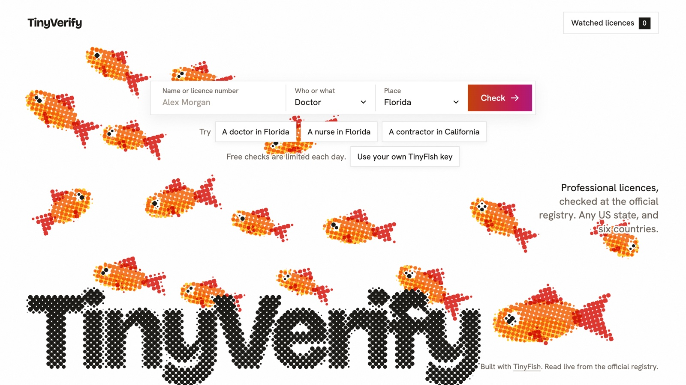

# TinyVerify



You're about to let a contractor take the roof off your house. He says he's licensed, and hands you a card with a number on it.

Somewhere there is an official register that knows if that is true. You would have to find the right board, work its search form, and make sense of the record. Most people don't. They trust the card.

TinyVerify does that part for you. You type a name or a licence number, say what kind of record it is, and where. It reads the official register, live, and tells you what the register says. That means the status, the number, the expiry date, and any discipline on file. It also gives you the link to the official page, so you never have to take its word. Then it can keep watching that record and tell you when it changes.

It works for doctors, nurses, dentists, pharmacists, contractors and companies.

Try it: https://tinyverify.tinyverify.workers.dev

I built this for TinyFish's Student Bounty Drop 002. It is one Cloudflare Worker with a D1 database, and it uses four TinyFish endpoints: Agent, Fetch, Search and Monitor.

## The one rule

An AI agent is good at working a search form. It will also tell you, with a straight face, what it thinks the page said.

On one early run the agent gave me a status, two dates and a discipline flag for a California contractor. The page it had captured showed only the licence number. It had done the hard part, finding the record, and then filled in the rest.

A confident wrong answer is the worst thing a tool like this can give you. So I made one rule and built everything around it:

> A value is shown only if code found it on a page the register served.

The agent's answer is never passed through. The run captures the pages it saw, code reads them, and only what the code finds reaches you. When the code can't confirm a value, you get `needs_review` and the official link, and no record.

## Quick start

Start a check. The names and numbers in these examples are made up.

```bash
curl -s https://tinyverify.tinyverify.workers.dev/verify \
  -H 'content-type: application/json' \
  -d '{"record_type":"physician","jurisdiction":"US-FL","licence_number":"ME000000"}'
```

The reply has a `check_id` and a `state`. Read the check until the state is `done`:

```bash
curl -s https://tinyverify.tinyverify.workers.dev/verify/chk_00000000-0000-0000-0000-000000000000
```

A finished match, shortened:

```json
{
  "check_id": "chk_00000000-0000-0000-0000-000000000000",
  "state": "done",
  "outcome": "match",
  "checked_at": "2026-11-10T09:00:00Z",
  "records": [
    {
      "registry": { "id": "fl-mqa", "name": "Florida Department of Health, MQA licence verification" },
      "source_url": "https://mqa-internet.doh.state.fl.us/...",
      "subject": { "name": "DANA EXAMPLE", "kind": "person", "city": "TAMPA" },
      "licence": {
        "type": "Medical Doctor",
        "status": "active",
        "status_raw": "CLEAR/ACTIVE",
        "issued": "2011-06-01",
        "expires": "2028-01-31"
      },
      "discipline": { "checked": true, "on_file": false, "actions": [] },
      "verification": { "readers": ["parser_html", "parser_text"], "agree": true },
      "evidence": { "quotes": ["License Status CLEAR/ACTIVE"], "snapshot_id": "snp_...", "content_sha256": "..." }
    }
  ]
}
```

`status` is one of ten plain words: `active`, `expired`, `suspended`, `revoked`, `surrendered`, `inactive`, `probation`, `pending`, `delinquent` or `other`. `status_raw` is the register's own wording. `evidence` points at the stored copy of the page, which you can fetch from `/evidence/:snapshot_id`.

Every finished check ends in exactly one of these:

| Outcome              | What it means                                                                    |
| -------------------- | -------------------------------------------------------------------------------- |
| `match`              | One record, read from the official register.                                     |
| `multiple_matches`   | Several records fit. You get the list and what tells them apart. None is picked. |
| `no_match`           | The register was searched and says it has no such record.                        |
| `needs_review`       | A page was read but a value could not be confirmed on it. No record is shown.    |
| `source_unavailable` | The register could not be read. You get the reason and when to try again.        |
| `unsupported`        | No official register could be read for this place. You get its link if found.    |
| `invalid_input`      | The request is missing something, or holds a value that is not accepted.         |

## How it works

Every state keeps its own register, and every register has its own search form. So there are two ways to an answer.

### Registers I wrote an adapter for

There are three, in `src/registries/`: Florida health professions (`fl-mqa`), Florida contractors (`fl-dbpr`) and California contractors (`ca-cslb`).

An Agent run works the register's search form. Then the record page is read by two parsers that share no code. One walks the HTML. The other reads the page as lines of text. You get a record only when the two agree. They must match on the status, the licence number, the expiry date and whether discipline is on file.

Why two? Registers change their pages without telling anyone. One parser reading the wrong cell hands you a wrong status and sounds sure about it. Two parsers that work differently will disagree instead, and a disagreement comes back as `needs_review`.

### Everywhere else

Any other US state, and Australia, the United Kingdom, Singapore, Canada, India, New Zealand and Ireland, go through `src/lookup/generic.ts`.

Search finds the register. A result counts only if its host belongs to that government. That means a `.gov` host naming that state, `state.<code>.us`, or a listed host for a country. Then an Agent run works the search and reports a name, a number, a status and a link.

Code then looks for each of those on the pages the run captured. The number must be the one you asked for. The status must sit where the page shows a status. The link must be on an official host.

### Around both

A name search can return many people. Each row is scored against the name you typed (`src/lookup/match.ts`). You get a record only when one row is clearly ahead. Otherwise you get all the plausible ones and choose by `candidate_id`.

TinyFish allows two Agent runs at once, and a Worker request can't wait minutes for one. So every run goes through a queue in D1 (`src/queue/queue.ts`). Before a run starts, the most it can cost is held against a daily limit. When it ends, what it used is written to a ledger, once per run.

A watch tells you when a licence changes (`src/watch/watch.ts`). Where a record has a stable link, a TinyFish Monitor watches the page and calls a webhook. Both parsers read the page again. It counts as a change only if the status, number, expiry, discipline or name moved. A page that only changed its "data as of" date is `unchanged`. Where there is no stable link, a daily Agent run reads the record again.

Each adapter is also checked on a schedule against a known public record (`src/watch/canary.ts`). `/status` tells you if its parsers still agree with values checked by hand.

## How TinyFish is used

- Agent works a register's search form, which no plain link can do. Its answer is checked against the pages it captured and is never shown as it stands.
- Fetch reads a Florida record page once a search has given its link. A lookup by number whose link is already known needs only this, and comes back in seconds.
- Search finds the official register for a place with no adapter. Results on hosts that don't belong to that government are dropped.
- Monitor watches a record page and calls a webhook when it changes. Code then decides if a licence field changed, or only the page did.

## API

Everything the demo page does, you can do with `curl`.

| Route                                   |                                                                                     |
| --------------------------------------- | ----------------------------------------------------------------------------------- |
| `POST /verify`                          | Start a check, or choose one of several matches with `check_id` and `candidate_id`. |
| `GET /verify/:id`                       | Read a check. Poll every 3 seconds until `state` is `done`.                         |
| `GET /evidence/:snapshot_id`            | The stored page a record was read from. Add `/screenshot` for the picture.          |
| `POST /watch`                           | Watch a licence. Needs an API key.                                                  |
| `GET /watch/:id`, `/watch/:id/events`   | A watch and its history.                                                            |
| `POST /watch/:id/check-now`             | Read the record now.                                                                |
| `DELETE /watch/:id`                     | Stop a watch.                                                                       |
| `GET /watches/public`                   | The demo's own watches and their latest events.                                     |
| `GET /registries`, `/status`, `/health` | The adapters, their health, and the day's budget.                                   |
| `POST /mcp`                             | The same service as MCP tools, for an AI agent.                                     |

`POST /verify` takes three things. `record_type` is `physician`, `dentist`, `nurse`, `pharmacist`, `contractor` or `company`. `jurisdiction` is a US state by name or code, or a country. The third is either `licence_number` or `name`. `city` narrows a name search. `include_complaints` also reads the register's complaint view, where it has one. For a company, `licence_number` is its registration number.

A lookup by number on a Florida register takes seconds. A name search, or a place with no adapter, takes one to three minutes.

The demo is free, so it has limits. Without a key, one address can start 20 live lookups an hour, and all visitors share US$1 a day. When that is spent, lookups return `source_unavailable` until midnight UTC.

You can skip the shared budget by sending your own TinyFish key in an `X-TinyFish-Key` header. The lookup then runs on your account. The key is used for that one lookup, kept encrypted until the lookup has an answer, then deleted. It is never logged or returned.

Keys for watches go in `Authorization: Bearer <key>`. Errors look like `{"error":{"code":"invalid_input","message":"..."}}`.

The MCP server at `/mcp` has six tools: `verify_licence`, `get_check`, `refine_match`, `watch_licence`, `get_watch` and `list_registries`. Each returns the same JSON as its route.

## What happened when I tried it

Tests only prove it can read the pages I saved. So I pointed it at registers it had never seen, in November 2026. This is every try, including the ones that came back empty.

| Register                               | Lookup         | Result                                                                       |
| -------------------------------------- | -------------- | ---------------------------------------------------------------------------- |
| Texas, physician                       | by number      | Match, 152 s.                                                                |
| New York, nurse                        | by number      | Match, 84 s.                                                                 |
| Washington, contractor                 | by number      | Nothing shown on the first two tries. After a fix, match twice, 88 and 74 s. |
| United Kingdom, physician              | by common name | Nothing shown, then "10 records under this name, add the licence number".    |
| United Kingdom, Companies House        | by number      | Match, 172 s.                                                                |
| New Zealand, Companies Office          | by number      | Match, 212 s.                                                                |
| Florida, Division of Corporations      | by name, twice | "20 records under this name, add the registration number", then nothing.     |
| Ireland, Companies Registration Office | by number      | The search asked for a CAPTCHA, so the run stopped.                          |
| Washington, Corporations and Charities | by number      | "No company with that number". I did not check that number by hand.          |
| California, Secretary of State         | by name        | Nothing shown. The business search would not open for the run.               |

Fifteen lookups. Six came back with a record. None showed a wrong value.

## What doesn't work yet

Fifteen lookups is a small sample, and these are still open:

- A lookup by name, on a register with no adapter, has not returned a record. The best answer so far is a count and a request for the number. Lookups by number are the reliable path.
- A watch has recorded `unchanged` on live licences. It has not yet seen a real licence change status. That path is covered by tests, and by replaying archived pages where a status did change (`scripts/replay.ts`).
- A lookup on your own TinyFish key is covered by tests. I have not run it live with a second real key.
- Australia's health register (Ahpra) is listed but has no adapter.
- If a register puts a CAPTCHA or a sign-in before its search, you get `source_unavailable`. TinyVerify does not try to get around it.

## Run it

You need Node 20 or later, a Cloudflare account and a TinyFish API key.

```bash
npm install
```

```bash
npm test
```

For local runs, copy `.dev.vars.example` to `.dev.vars`, fill it in, and start the Worker:

```bash
npm run dev
```

To deploy, create the database and put the printed id in `wrangler.toml`:

```bash
npx wrangler d1 create tinyverify
```

Set `TINYFISH_API_KEY`, `HOOK_SECRET`, `OWN_KEY_SECRET`, `ADMIN_KEY` and `API_KEYS` with `npx wrangler secret put NAME`. `.dev.vars.example` lists them. Then apply the schema and deploy:

```bash
npx wrangler d1 migrations apply tinyverify --remote
```

```bash
npm run deploy
```

## Files

```
src/
  index.ts      Worker entry: requests and cron ticks
  http/         REST routes, webhooks, the MCP server
  lookup/       one lookup from request to answer
  registries/   an adapter and two parsers for each register
  queue/        the Agent run queue and spending limits
  watch/        watches and the scheduled health checks
  tinyfish/     client for the TinyFish API
  web/          the demo page
tests/          run inside the Workers runtime
  fixtures/     saved register pages with personal details replaced
scripts/        capture a page into a fixture, replay two archived pages
migrations/     D1 schema
assets/         the picture above
```

## Licence

MIT
